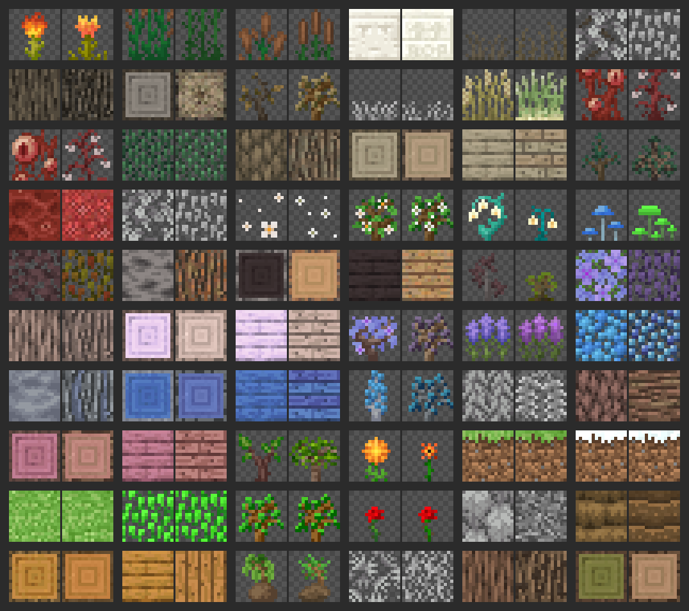

# Biomes O' Plenty – old textures (Horizon)

Horizon's Biomes O' Plenty port (0.2.7) with 135 of its textures back to Biomes O' Plenty 1.12's
(7.0.0.2291): the old look for the woods, leaves, saplings, doors, flowers, grasses and sands.

It is the whole BOP mod, id `biomesoplenty`, not an add-on. A Horizon content mod can only change
files in its own namespace and declares blocks only under its own id, and mods' files sit above
resource packs. Put it in place of the BOP that comes with Horizon: the blocks, items, biomes and
worlds are the same.

## What changes



- The logs, log tops, planks, leaves, saplings, doors and door items of fir, hellbark, jacaranda,
  magic, mahogany, palm, pine, redwood, umbran, willow and dead wood, and the boat items.
- The Origin grass block, leaves, sapling and rose; flowering oak leaves and sapling.
- Flowers (burning blossom, glowflower, lavender, orange cosmos, pink daffodil, pink hibiscus,
  violet, wilted lily), grasses (dead, desert, dune), sprouts, tiny cactus, toadstool, glowshroom,
  cattails, reeds, eyebulbs, willow vines and flesh.
- White sand and white sandstone; the blood bucket and the Wanderer disc.

Where the two versions tint differently, the old texture is adjusted to match how 26.3 draws it:
dead leaves, desert grass and sprouts are tinted by the game now, so they are made grey; redwood
leaves were tinted in 1.12 and are not now, so they take the 26.3 colour. Eyebulbs and flesh are
still in 1.12, so they no longer animate.

Unchanged: clover and the blood fluid (1.12's are different things), boats (the old texture layout
does not fit the new model), and everything added to BOP after 1.12.

## Building

```sh
python3 -I tools/oldbop.py <unpacked biomesoplenty.hmod 0.2.7> <unpacked 1.12 jar> mod
cd mod && cargo horizon-mod build
```

`tools/compare.py` draws the sample sheets.

## Credits

Biomes O' Plenty by Adubbz, Amnet, Cheeserolls, Forstride and ted80 (CC BY-NC-ND 4.0), used with
permission. The Horizon port of Biomes O' Plenty is Horizon's.
